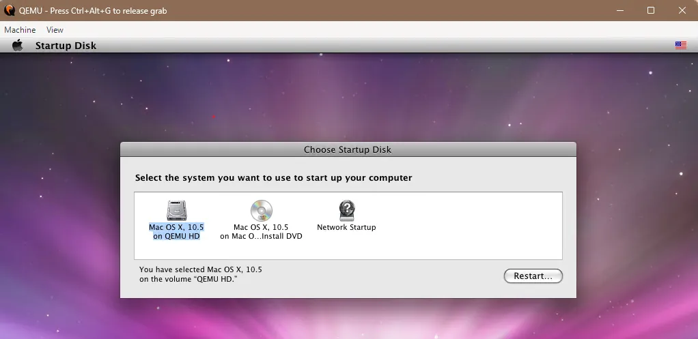

# Mac OS X 10.5 (QEMU/PowerPC)

### 1. Personal History

When Mac OS X 10.5 Leopard arrived on October 26, 2007, there was a feeling of excitement and anticipation surrounding Apple. It was more than the release of another operating system. There was an underlying message that Apple had been communicating for several years: Mac OS X was here to stay, and Apple was only getting started.

Mac OS X 10.3 Panther and, particularly, 10.4 Tiger had already established that Apple could deliver a modern operating system capable of competing with, and in some areas surpassing, what the rest of the industry had to offer. By the time Tiger arrived, I felt that Apple had finally caught up. In fact, I would argue that in several respects, it had moved ahead.

Leopard represented something different.

For the first time, it seemed that Apple was no longer particularly concerned with proving that it could compete with Microsoft or anyone else. Rather than playing catch-up or introducing features simply because another operating system already had them, Apple appeared focused on building the best experience it could envision.

There was a confidence about Apple during this period that was difficult to ignore.

And there was simply so much happening at Apple.

Every time Steve Jobs walked onto a stage, there was a genuine sense that we were about to see something interesting. Sometimes it was a new Macintosh, sometimes a refinement of an existing product, and sometimes something entirely unexpected. The Intel transition, the MacBook Pro, the Mac Pro, the evolution of the iPod, and ultimately the introduction of the iPhone in January 2007 all contributed to the feeling that Apple was operating at an extraordinary pace.

It was a fascinating time to be an Apple enthusiast, particularly if your relationship with the company predated Steve Jobs' return and the introduction of the original iMac in 1998.

Because while the new Apple was moving forward at an extraordinary pace, the Apple that many of us had grown up with was disappearing.

The transition from PowerPC to Intel, announced in June 2005, was perhaps the most significant example. For me, this was particularly bittersweet. I was an enormous fan of the PowerPC architecture, and I remain one to this day. There was something wonderfully exotic about those processors, particularly during the PowerBook era, when owning and using a Macintosh meant experiencing a computing architecture fundamentally different from the Intel-based PCs that dominated the market.

Moving to Intel made perfect sense from a business and engineering perspective, but it also meant giving up something that I had genuinely enjoyed. The PowerBook G4 represented a particular period of Macintosh computing that I remember with tremendous affection, and the transition to the MacBook Pro, regardless of its advantages, marked the end of that experience.

Nonetheless, I purchased a MacBook Pro from Fry's Electronics as soon as they became available. As much as I loved the PowerPC architecture, my enthusiasm for what Apple was doing next far outweighed any nostalgia I felt for what was being left behind.

I could appreciate the end of one era without allowing it to diminish my excitement for what was next.

Leopard itself was something of a bridge between these two worlds. It supported both PowerPC and Intel Macs, but it also marked the end of the Classic environment that had allowed users of supported PowerPC Macs to continue running applications from the original Mac OS era. With Snow Leopard in 2009, PowerPC support itself would disappear.

But unlike some longtime Macintosh enthusiasts, I had relatively little nostalgia for System 7, Mac OS 8, or Mac OS 9.

I was, first and foremost, a command-line person.

As much as I could appreciate the history of the Macintosh and its influence on personal computing, the classic Mac OS had never offered me much that I considered particularly useful for the way I wanted to work. Its graphical interface was certainly approachable, but underneath it was an operating system that lacked many of the capabilities and conventions I had come to expect from UNIX and other command-line environments.

Consequently, I wasn't particularly interested in preserving the old Macintosh operating system. Quite the opposite. I was entirely in favor of the direction Apple was taking, and I couldn't wait to see the last vestiges of the old Apple disappear for good.

What excited me about Mac OS X was the combination of a modern graphical environment with a genuinely capable UNIX foundation.

At its heart was XNU, Apple's hybrid kernel incorporating Mach and BSD components, along with I/O Kit for driver management. The operating system also provided a substantial BSD userland, giving me access to the command-line tools, development environments, and UNIX conventions that I valued.

Apple had not simply introduced these technologies with Mac OS X 10.0 and left them alone. Over the following years, the underlying system had matured enormously. Apple had also brought in people with substantial experience developing UNIX operating systems, including Jordan Hubbard, one of the founders of the FreeBSD project, who joined Apple in 2001.

By the time Leopard arrived, the difference between the UNIX environment in Mac OS X 10.0 and what Apple was delivering in 10.5 was, in my opinion, extraordinary. What had initially felt like a promising but immature operating system had developed into a remarkably capable UNIX workstation.

And then there was Aqua.

Apple had continued refining its graphical interface throughout the Panther and Tiger years, improving responsiveness, consistency, and the integration between applications and the underlying operating system. Compared with my experiences using the earliest releases of Mac OS X, the graphical environment had become dramatically faster and more polished.

By Leopard, I felt that Apple had managed to combine two things that had traditionally been difficult to bring together: a powerful UNIX environment and a graphical desktop that was genuinely enjoyable to use.

It was also a period when Apple was becoming increasingly comfortable embracing the same industry standards used by conventional PC manufacturers.

Technologies such as PCI, ATA, USB, and DVI had already found their way into Macintosh hardware over the preceding years. With the transition to Intel, the underlying hardware became even more familiar. For someone accustomed to the more proprietary aspects of earlier Macintosh systems, there was something refreshing about being able to purchase ordinary components and peripherals without necessarily requiring a Macintosh-specific solution.

But Apple had not stopped innovating simply because it was embracing established technologies. Instead, it seemed to have discovered that innovation did not always require reinventing the underlying hardware. Sometimes it meant taking existing technologies and combining them in ways that made the overall experience substantially better.

Leopard was an excellent example of that philosophy.

Features such as Time Machine, Quick Look, Spaces, and the redesigned Finder were not necessarily revolutionary concepts in isolation. But the way Apple integrated them into the operating system demonstrated a level of attention to the overall user experience that I found particularly compelling.

For me, Mac OS X 10.5 represented a commitment to everything Apple had spent the previous six years building.

It wasn't simply a promise to maintain the new ecosystem. It was a statement that Apple intended to continue developing it, improving its UNIX foundations, refining Aqua, embracing industry standards, and introducing capabilities that pushed the operating system forward.

And if that meant abandoning older technologies, changing established conventions, or even removing features that some of us had grown attached to, then so be it. I would rather see an operating system continue evolving than watch it become stagnant in the name of preserving the past.

Ironically, I would come to lament aspects of this very philosophy with the arrival of Mac OS X 10.6 Snow Leopard.

But that's a story for another time.

Looking back, I tend to see Leopard as the beginning of another chapter in the evolution of Mac OS X, one whose influence would remain visible for much of the following decade.

Two things seemed certain to me at the time. The old Apple, with its classic Macintosh operating system and the PowerPC machines I loved, was effectively gone.

I would miss the PowerPC machines, but I had little desire to return to the classic Macintosh operating system. What excited me was not what Apple had left behind, but what it was building in its place.

The new Apple was here to stay, and with Mac OS X 10.5 Leopard, it felt as though we were only beginning to discover what that meant.

---

### 2. Version History - Mac OS X 10.5 Leopard

## 10.5.0

**Released:** October 26, 2007  
**Build:** 9A581 | **Darwin:** 9.0

- Initial retail release of Mac OS X Leopard.
- Introduced Time Machine for automated, versioned file backups.
- Introduced Quick Look for previewing documents and media directly from Finder.
- Introduced Spaces for organizing applications across multiple virtual desktops.
- Redesigned Finder with Cover Flow, a sidebar, and enhanced network browsing.
- Introduced a translucent menu bar, three-dimensional Dock, and Stacks.
- Introduced Core Animation for application interface development.
- Expanded 64-bit application support, including 64-bit graphical applications.
- Introduced Boot Camp as an integrated feature for Intel-based Macs.
- Introduced a new application-level firewall.
- Expanded Spotlight search functionality.
- Updated Mail with Notes, To Do items, and stationery templates.
- Updated iChat with screen sharing, video effects, and iChat Theater.
- Updated Safari with Web Clip functionality.
- Introduced improvements to Preview, Automator, and Dictionary.
- Updated Xcode to version 3.0.
- Removed the Classic environment used to run Mac OS 9 applications.
- Supported both PowerPC G4/G5 and Intel processors, subject to hardware requirements.

---

## 10.5.1

**Released:** November 15, 2007  
**Build:** 9B18 | **Darwin:** 9.1

- Corrected application firewall rules that failed to block certain processes running as root.
- Fixed firewall configuration changes not immediately affecting services launched by launchd.
- Addressed additional security vulnerabilities.
- Improved operating system compatibility and reliability.
- Updated several built-in applications and system components.

---

## 10.5.2

**Released:** February 11, 2008  
**Build:** 9C31 | **Darwin:** 9.2

- Added an option to disable menu bar transparency.
- Added additional display options for folder Stacks in the Dock.
- Improved Finder stability and network volume handling.
- Added a Time Machine menu bar item.
- Improved Time Machine backup reliability with external drives.
- Corrected Time Machine issues involving computer names containing special characters.
- Improved wireless networking compatibility.
- Fixed printing problems involving Microsoft Office applications.
- Corrected printing options for certain Windows-shared printers.
- Added support for additional printers connected through AirPort base stations.
- Improved login performance and stability.
- Fixed an issue that could cause Setup Assistant to appear repeatedly.
- Improved Safari domain resolution.
- Added RAW image compatibility for additional digital cameras.
- Improved Automator search and filtering operations.
- Updated language and keyboard layout support.
- Included security and application compatibility fixes.

---

## 10.5.3

**Released:** May 28, 2008  
**Build:** 9D34 | **Darwin:** 9.3

- Improved Finder reliability and file handling.
- Addressed networking and file-sharing compatibility issues.
- Improved Time Machine reliability.
- Updated Mail and iCal functionality.
- Improved printing and application compatibility.
- Corrected a security issue involving client SSL certificates in CFNetwork.
- Fixed CoreFoundation memory handling vulnerabilities.
- Addressed PDF processing vulnerabilities in CoreGraphics.
- Improved kernel handling of malformed network packets.
- Fixed kernel code-signature validation issues.
- Improved security validation for downloaded files.
- Addressed vulnerabilities in iCal file processing.
- Included additional system and application security fixes.

---

## 10.5.4

**Released:** June 30, 2008  
**Build:** 9E17 | **Darwin:** 9.4

- Improved general system reliability and compatibility.
- Addressed compatibility problems involving Adobe Creative Suite 3.
- Updated system security components.
- Improved validation of potentially unsafe downloaded content.
- Addressed additional application and system vulnerabilities.
- Included fixes for networking and application behavior.

---

## 10.5.5

**Released:** September 15, 2008  
**Build:** 9F33 | **Darwin:** 9.5

- Improved application compatibility and stability.
- Updated graphics and display-related components.
- Addressed networking and file-sharing issues.
- Improved reliability of built-in applications.
- Included additional security fixes.
- Updated support for contemporary Macintosh hardware.

---

## 10.5.6

**Released:** December 15, 2008  
**Build:** 9G55 | **Darwin:** 9.6

- Improved AirPort wireless connection reliability.
- Improved Mail performance and stability.
- Improved MobileMe synchronization of contacts, calendars, and bookmarks.
- Improved compatibility with AT&T 3G data cards.
- Fixed Time Machine errors reporting that backup volumes could not be found.
- Improved Time Machine reliability with Time Capsule.
- Improved Safari compatibility with web proxy servers.
- Updated system components and security protections.
- Improved general application compatibility.

---

## 10.5.7

**Released:** May 12, 2009  
**Build:** 9J61 | **Darwin:** 9.7

- Improved operating system reliability and hardware compatibility.
- Updated networking and system security components.
- Updated Apache to version 2.2.11.
- Updated PHP to version 5.2.8.
- Fixed vulnerabilities involving CoreGraphics PDF processing.
- Improved handling of potentially malicious disk images.
- Fixed a Terminal window-size vulnerability.
- Addressed an IPv6 networking vulnerability.
- Corrected OpenSSL certificate verification problems.
- Improved iChat SSL connection behavior.
- Fixed vulnerabilities affecting Spotlight's Microsoft Office file importer.
- Updated security components used by X11.
- Updated libpng to version 1.2.35.
- Addressed additional kernel and application vulnerabilities.

---

## 10.5.8

**Released:** August 5, 2009  
**Build:** 9L30 | **Darwin:** 9.8

- Final point release of Mac OS X Leopard.
- Improved AirPort connection compatibility and reliability.
- Fixed an issue causing certain display resolutions to disappear from System Preferences.
- Improved Bluetooth reliability.
- Updated bzip2 to version 1.0.5.
- Improved ColorSync profile validation.
- Fixed vulnerabilities involving RAW image processing.
- Addressed security problems in ImageIO involving PNG, OpenEXR, and EXIF data.
- Fixed a kernel privilege-escalation vulnerability involving fcntl system calls.
- Improved launchd error handling for network services.
- Corrected a security issue involving multitouch gestures while the screen was locked.
- Improved login window security.
- Addressed vulnerabilities in AppleTalk packet processing.
- Updated PCRE to version 7.6.
- Included additional compatibility, stability, and security corrections.
- Final Mac OS X point release supporting PowerPC hardware.

---

### References

Apple's archived release documentation and security advisories:

- [Mac OS X 10.5.1 Update](https://support.apple.com/en-gb/106462)
- [10.5.1 security changes](https://support.apple.com/en-ie/102685)
- [10.5.3 security changes](https://support.apple.com/en-gb/102486)
- [10.5.4 security changes](https://support.apple.com/de-de/102582)
- [10.5.7 security changes](https://support.apple.com/en-ie/104129)
- [10.5.8 update](https://support.apple.com/de-de/106460)
- [10.5.8 security changes](https://support.apple.com/de-de/104141)

---

### 3. Installation

The preparation work for installing Mac OS X 10.5 Leopard under QEMU is largely the same as it was for Mac OS X 10.4 Tiger.

Assuming `qemu-system-ppc` is already installed, we'll start by creating the qcow2 image that will serve as our virtual hard disk.

```bash
qemu-img create -f qcow2 MacOSX105.qcow2 40G
```

**Note:** The installation size of Mac OS X 10.5 is significantly larger than that of 10.4, hence the increase to 40GB.

As with my other QEMU installations, I use batch files or shell scripts to start the VM, depending on the host operating system.

#### Batch File Version

**start-cd.bat**

```batch
"C:\Program Files\qemu\qemu-system-ppc.exe" ^
    -L pc-bios ^
    -M mac99,via=pmu ^
    -m 2048M ^
    -g 1024x768x32 ^
    -boot d ^
    -hda MacOSX105.qcow2 ^
    -cdrom "MacOSX105.iso" ^
    -netdev tap,ifname=TAP0,id=network0 ^
    -device sungem,netdev=network0
```

#### Shell Version

**start-cd.sh**

```bash
#!/bin/sh

qemu-system-ppc \
    -L pc-bios \
    -M mac99,via=pmu \
    -m 2048M \
    -display gtk \
    -g 1024x768x32 \
    -boot d \
    -hda MacOSX105.qcow2 \
    -cdrom "MacOSX105.iso"

#-netdev tap,ifname=TAP0,id=network0 -device sungem,netdev=network0
```

Starting QEMU, the installation ISO boots happily into a very polished language selection screen, followed by a Welcome screen where, I must admit, I have never actually clicked **More Information**.

Continuing through the obligatory license agreement, we're presented with no disks available for installation. A quick stop at **Utilities → Disk Utility** allows us to erase the 40GB virtual hard disk without having to partition it as a separate preliminary step.

Unlike my experience installing 10.4, **Mac OS Extended (Journaled)** is already selected as the default filesystem, while **Install Mac OS 9 Disk Drivers** remains unchecked. I'll name the volume **QEMU HD** and erase it.

Exiting Disk Utility, our newly formatted QEMU HD is now available as an installation destination.

Continuing to the **Install Summary** screen, I can reduce the installation footprint by deselecting **Printer Drivers** and **Language Translations**, bringing the required disk space down to approximately 6.1GB.

I'm happily leaving **X11** selected, which, if anything, lends psychological credence to the notion that I am, in fact, using a UNIX-based workstation.

And off we go.

Installation takes considerably longer than its Intel counterpart, approximately an hour in my case when emulating PowerPC hardware on a modern system.

Unfortunately, when the installation completes, I'm greeted with an **Installation Failed** message, informing me that the installer could not configure **QEMU HD** as the startup volume.

This is a problem I've encountered in various forms over the years on both PowerPC and Intel-based Macs. Both architectures rely on firmware settings to identify the preferred startup volume, although PowerPC uses Open Firmware while Intel Macs use EFI.

On PowerPC systems, Open Firmware normally consults the `boot-device` variable stored in NVRAM to locate the startup disk. If that information is missing or incorrect, the firmware must locate another bootable device, which isn't always successful, particularly under emulation.

On Intel-based Macs, I've experienced something similar, although the result was usually an extraordinarily long pause while the firmware searched for a bootable volume.

Fortunately, in this case, the operating system appears to have been installed successfully. What failed was the final step of configuring the startup volume.

The solution is relatively simple. Rather than clicking **Restart** on the installation failure screen, I open **Utilities → Startup Disk**, select **Mac OS X 10.5 on QEMU HD**, and click **Restart**.



Once the virtual machine restarts, I can shut down QEMU and switch to my hard disk startup scripts.

With that, the installation is complete.
